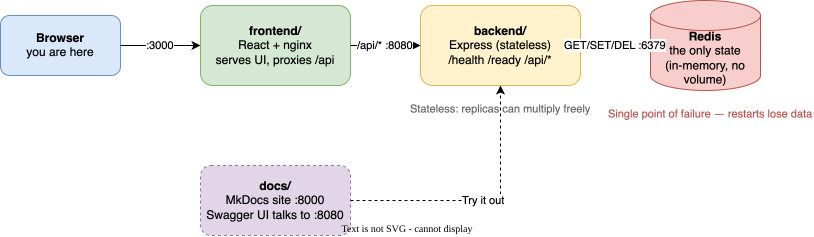

# 1 · The big picture

One repo, three moving parts. The whole project exists to teach how a
**stateless** HTTP service talks to a **stateful** dependency — and what breaks
when you scale or failover.

| Component | Code | Job |
|---|---|---|
| Frontend | `frontend/` | React app served by nginx; proxies `/api` to the backend so the browser sees one origin |
| Backend | `backend/` | Express service — the only thing that touches Redis |
| Redis | `redis:7-alpine` | Holds every key; in-memory, no volume, single replica |
| Docs | `docs/` | This site, plus embedded Swagger UI that calls the API directly from your browser |

## The one mental model

!!! tip "Remember this"
    Backend replicas are cattle — kill one and nothing is lost.
    Redis is a pet — kill it and **all data is gone**. There is no volume,
    no replication, no persistence anywhere in this project.

- `/health` and `/ready` exist so an orchestrator can tell "process alive"
  apart from "Redis reachable" — covered in [step 5](05-health-readiness.md).
- `/api/info` reports which **region / cluster / pod** answered, which is what
  makes multi-region demos visible — covered in [step 8](08-multi-region.md).

!!! warning "Not production"
    No auth, no TLS, unrestricted CORS, errors leak internals, and the Redis
    URL is logged at startup. Trusted networks and synthetic data only.

---

Next: [2 · Run it locally](02-run-locally.md)
