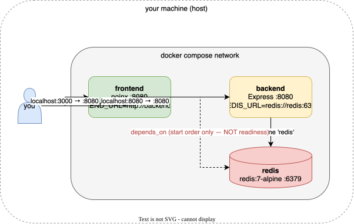

# 2 · Run it locally

One command starts the whole system:

```sh
docker compose up --build
```



| You type | Compose routes to |
|---|---|
| <http://localhost:3000> | `frontend` container (nginx :8080) |
| <http://localhost:8080> | `backend` container (Express :8080) |
| `localhost:6379` | `redis` container |

!!! warning "depends_on ≠ ready"
    Compose starts Redis *before* the backend but does **not** wait for Redis
    to accept connections. Watch `docker compose logs backend` — `/ready`
    stays 503 until the client connects.

## Prove it works

```sh
curl -i http://localhost:8080/health    # {"status":"ok"} — always, Redis or not
curl -i http://localhost:8080/ready     # 200 once Redis connects
curl    http://localhost:8080/api/info  # region, cluster, pod, version, redis state
```

Then write and read a key:

```sh
curl -i -X PUT http://localhost:8080/api/kv/greeting \
  -H 'Content-Type: application/json' \
  -d '{"value":"hello","ttlSeconds":60}'
curl http://localhost:8080/api/kv/greeting
curl http://localhost:8080/api/kv
curl -X DELETE http://localhost:8080/api/kv/greeting
```

Expect: PUT → `201` (even when replacing), GET missing key → `404`,
DELETE absent key → `{"deleted":0}`.

Stop with `docker compose down` — **all keys are lost**, by design.

## Run without Docker

Backend (needs a Redis on `localhost:6379`):

```sh
cd backend && npm ci && npm run dev
REDIS_URL=redis://localhost:6379 REGION=local CLUSTER_NAME=my-machine npm start
```

Frontend (`/api` is proxied to `localhost:8080` by Vite):

```sh
cd frontend && npm ci && npm run dev   # http://localhost:3000
```

## Serve this documentation site

```sh
uv venv
uv pip install -r requirements-docs.txt
uv run --no-project mkdocs serve -a 127.0.0.1:8000
```

| Resource | URL |
|---|---|
| Docs home | <http://127.0.0.1:8000/> |
| Swagger UI (embedded) | <http://127.0.0.1:8000/articles/swagger/> |
| OpenAPI YAML | <http://127.0.0.1:8000/api/openapi.yaml> |

The docs server is separate from the API — there are **no** `/docs` or
`/swagger` routes on port 8080. Keep `docker compose up` running for
Swagger's **Try it out**.

## Troubleshooting

- **Port in use** — stop whatever owns 3000/6379/8000/8080.
- **`/ready` stays 503** — `docker compose logs redis backend`; retry after Redis starts.
- **A key disappeared** — check its TTL and which region answered (`/api/info`). Data is not replicated.
- **Swagger blank** — its JS/CSS come from jsDelivr CDN; needs network. Everything else works offline.

---

Next: [3 · Follow a request](03-request-flow.md)
