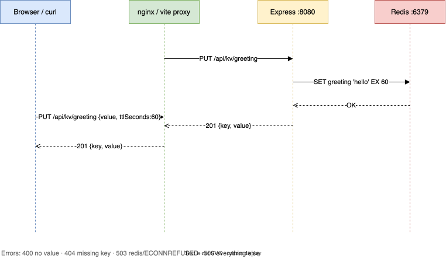

# 3 · Follow a request

Trace `PUT /api/kv/greeting {"value":"hello","ttlSeconds":60}` end to end.

1. **Browser/curl** hits `/api/kv/greeting`. In dev that's Vite (:3000); in a
   container it's nginx (:8080). Either way `/api` is proxied — the browser
   never talks to Express directly.
2. **Proxy** forwards to the backend unchanged.
3. **Express** validates (`value` must exist → `400`), converts the value with
   `String(value)`, and calls Redis.
4. **Redis** runs `SET greeting "hello" EX 60` and replies `OK`.
5. Response unwinds: `201 {"key":"greeting","value":"hello"}`.

## Where errors come from

| Status | Trigger | Emitted by |
|---|---|---|
| 400 | PUT body missing `value` | route handler |
| 404 | GET on a missing/expired key | route handler |
| 503 | message matches `redis`/`ECONNREFUSED`/`closed` | error middleware |
| 500 | everything else (incl. malformed JSON) | error middleware |

!!! note "Why malformed JSON is a 500"
    The error middleware discards body-parser's original `400` status — a
    quirk worth knowing before you copy this pattern.

## What the proxy hides

Because nginx terminates the browser connection, a dead backend looks like
**connection refused on `/api`**, not an Express error — that's what drives
the UI's `backend unreachable` banner ([step 7](07-frontend.md)).

---

Next: [4 · Redis data & TTL](04-redis-data.md)
