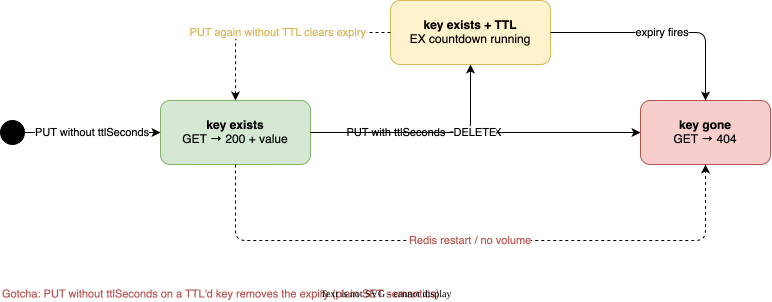

# 4 · Redis data & TTL

Everything the API stores lives in exactly one place: a single Redis process.

## Rules that will bite you

- **Values are strings.** The API does `String(value)`: `42` → `"42"`,
  `null` → `"null"`, `{}` → `"[object Object]"`. Send strings.
- **TTL is per-key seconds** via `ttlSeconds` → `SET … EX n`.
- **Re-PUT without `ttlSeconds` clears the expiry.** Plain `SET` semantics —
  the TTL is gone, the key lives forever.
- **`ttlSeconds: 0` means no TTL** (JS truthiness check, not validation).
  A truthy non-number like `"abc"` can explode in the Redis layer → 503.
- **`GET /api/kv` runs `KEYS *`.** Fine here; in a real system it blocks
  Redis on big datasets. Production answer: `SCAN`.
- **Keys are URL path params** — URL-encode anything special.
- **DELETE is idempotent-ish:** `{"deleted":0}` for a key that isn't there.

## Ways a key disappears

| Cause | Visible how |
|---|---|
| `ttlSeconds` expiry | GET → 404 after n seconds |
| `DELETE` | `{"deleted":1}` |
| Re-PUT… no, that *keeps* the key but kills the TTL | TTL silently gone |
| Redis restart / container replace | **everything** → 404 |

That last row is the big one: no `appendonly`, no RDB volume, no replica —
in Compose and in the k8s manifests alike.

## What this project does *not* configure

!!! warning "Known gaps"
    - No `maxmemory` / eviction policy → Redis fills up and writes start failing
    - No password, ACL, or TLS on `redis://`
    - No command timeout — requests **queue** during Redis outages instead of failing fast
    - `REDIS_URL` is printed in the startup log — don't put credentials in it

Full checklist in [9 · Gotchas & limits](09-gotchas.md).

---

Next: [5 · Health vs readiness](05-health-readiness.md)
