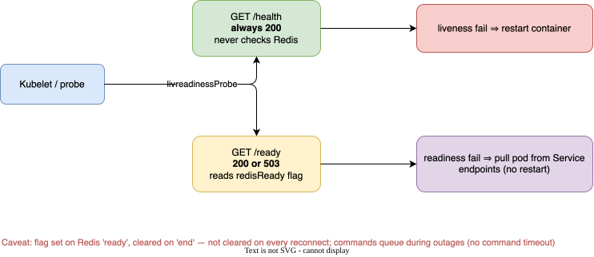

# 5 · Health vs readiness

Two probes, two different questions — Kubernetes acts on them differently.

| Endpoint | Answers | Behavior |
|---|---|---|
| `GET /health` | "Is the process alive?" | Always `200` — **never** checks Redis |
| `GET /ready` | "Can I serve traffic?" | `200`/`503` from the `redisReady` flag |

!!! tip "The pattern"
    Liveness fail ⇒ kubelet **restarts the container**.
    Readiness fail ⇒ pod is pulled from Service **endpoints**, no restart.

    If Redis dies, you want traffic to drain — not a restart loop. That's why
    `/health` deliberately ignores Redis.

## How the flag actually works

`redisReady` is set on the client's `ready` event and cleared on `end`. It is
**not** cleared on every reconnect or error, and nothing pings Redis per
request. So `/ready` = 200 is a hint, not a promise — the next command can
still queue during a reconnection.

Try it: `docker compose stop redis` → `/ready` flips to `503`, `/health`
still `200`, and `/api/kv` calls hang or 503 rather than failing cleanly.

---

Next: [6 · Explore the API](06-explore-api.md)
