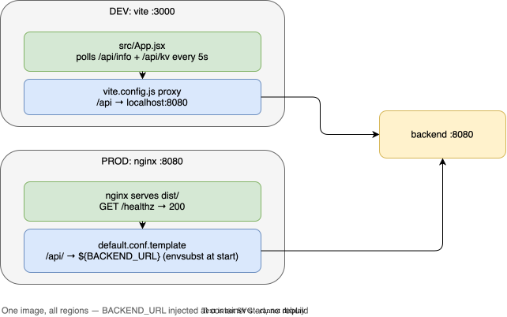

# 7 · Frontend tour

The UI is one React component whose whole job is making backend behavior
**visible**.

## Two cards, everything to observe

| Card | Shows | Backed by |
|---|---|---|
| Serving region | `region`, `cluster`, `pod`, `version`, `redis`, `startedAt` | `GET /api/info` |
| Key/value editor | all keys, set/get/delete | `GET/PUT/DELETE /api/kv` |

Both poll every **5 seconds** (`src/App.jsx`). Kill the backend and within
one poll a red **backend unreachable** banner appears — instant failover demo.

## Same image, every environment

There is exactly **one** UI image. `BACKEND_URL` is envsubst'd into the nginx
template at *container start* — so region A and region B run identical builds
with different env vars. Vite does the same job in dev with a hardcoded proxy
to `localhost:8080`.

## Try it yourself

With `docker compose up` running, open <http://localhost:3000>:

- [ ] Region card populates and refreshes ~every 5s
- [ ] Set `foo=bar`, reload — persists; delete — gone
- [ ] `docker compose stop backend` → banner in ≤5s → `start` → banner clears

Full manual checklist: [Frontend testing guide](frontend-testing.md).
Ops details: [Frontend architecture](frontend-architecture.md) ·
[deployment](frontend-deployment.md).

---

Next: [8 · Two regions](08-multi-region.md)
