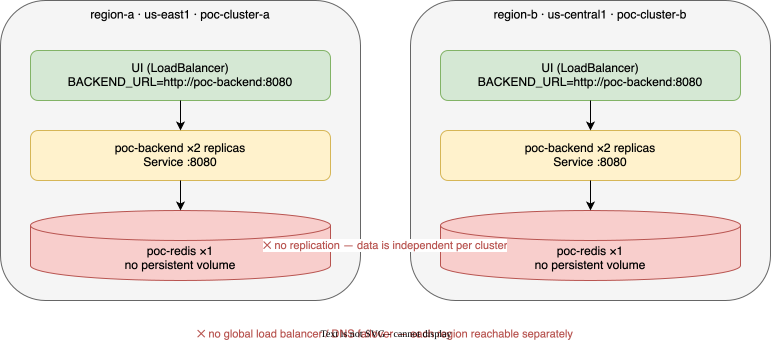

# 8 · Two regions

The k8s manifests deploy the *same* stack into two clusters. That's the demo —
and also the trap.



## What exists per cluster

- UI Deployment + `LoadBalancer` Service (the only public entry point)
- 2 × backend replicas behind a cluster-internal Service
- 1 × Redis, `Recreate` strategy, **no persistent volume**

## What does **not** exist

!!! danger "Two clusters ≠ one system"
    - **No replication** — region A's Redis and region B's Redis are
      independent. A key written in A is *not* in B.
    - **No global LB / DNS failover** — each UI is reachable on its own IP;
      nothing shifts traffic automatically.
    - **No persistence** — a Redis pod restart wipes that region's data.

So "failover" demos only *routing*: `/api/info` shows a different
region/cluster/pod. Data does not follow. Shared-looking state in the UI
checklist means *both views hit the same cluster's Redis*, not magic sync.

## Operator flow (reference)

```sh
kubectl kustomize backend/deploy/overlays/region-a   # render first
kubectl --context=cluster-a apply -k backend/deploy/overlays/region-a
kubectl --context=cluster-b apply -k backend/deploy/overlays/region-b
kubectl --context=cluster-a -n poc port-forward service/poc-backend 8080:8080
```

Details: [Frontend deployment](frontend-deployment.md) — image
placeholders, overlays, release workflow caveats.

---

Next: [9 · Gotchas & limits](09-gotchas.md)
