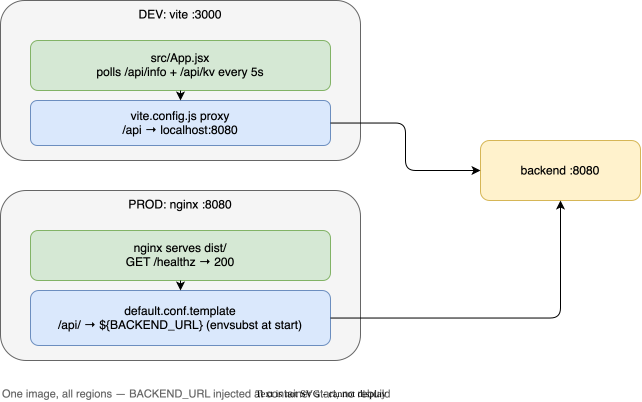

# Architecture

## Components



- **Vite dev server** (local dev): serves the React app on `:3000` and proxies
  `/api` to `http://localhost:8080` (`vite.config.js`).
- **nginx** (container): serves the static build on `:8080`, exposes `/healthz`,
  and proxies `/api/` to `${BACKEND_URL}` (`nginx/default.conf.template`).
- **React app**: a single component (`src/App.jsx`) that polls `/api/info` and
  `/api/kv` every 5 seconds and renders two cards — serving region and the
  Redis key/value editor.

## Single region-agnostic image

`BACKEND_URL` is substituted into the nginx template at container start via
envsubst (`/etc/nginx/templates`), so the same image is deployed unchanged to
every cluster:

```sh
docker build -t poc-ui .
docker run -p 8080:8080 -e BACKEND_URL=http://host.docker.internal:8080 poc-ui
```

## Repo layout

```
frontend/
├── src/App.jsx                  # entire UI — info card + Redis kv editor
├── vite.config.js               # dev server + /api proxy to :8080
├── nginx/default.conf.template  # prod serving + /api proxy via BACKEND_URL
├── Dockerfile                   # build → nginx image
└── .github/workflows/release.yml# version bump + tag + Artifactory push
```
