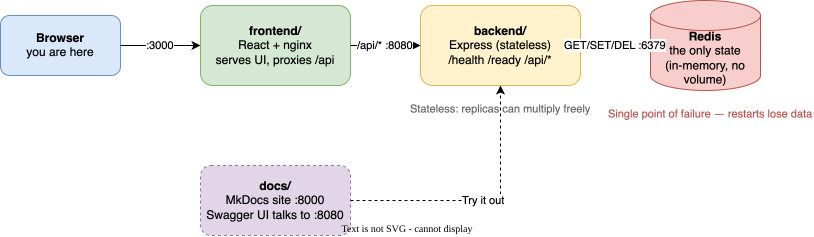

# Redis POC — learn it in 9 steps

A Redis-backed Express service plus a React test UI, packaged as one local
project that demos two-region deployment concepts. Read the path top to
bottom — each page builds on the last and every concept has a diagram.



## The learning path

| # | You'll learn | Diagram |
|---|---|---|
| [1 · The big picture](articles/01-big-picture.md) | what's stateless, what's stateful, why it matters | system map |
| [2 · Run it locally](articles/02-run-locally.md) | compose stack, ports, smoke-test curls | container topology |
| [3 · Follow a request](articles/03-request-flow.md) | browser → proxy → Express → Redis, error codes | sequence |
| [4 · Redis data & TTL](articles/04-redis-data.md) | key lifecycle, expiry traps, string-only values | state diagram |
| [5 · Health vs readiness](articles/05-health-readiness.md) | liveness/readiness probes and the flag's limits | probe flow |
| [6 · Explore the API](articles/06-explore-api.md) | OpenAPI + Swagger UI hands-on | — |
| [7 · Frontend tour](articles/07-frontend.md) | nginx proxy, 5s polling, one-image-per-region | UI topology |
| [8 · Two regions](articles/08-multi-region.md) | what "failover" does and doesn't give you | cluster map |
| [9 · Gotchas & limits](articles/09-gotchas.md) | every sharp edge in one table | — |

## Quick commands

```sh
docker compose up --build                          # everything: UI :3000, API :8080, Redis :6379
uv run --no-project mkdocs serve -a 127.0.0.1:8000 # this site + Swagger UI
```

## Reference

[API guide](articles/api-guide.md) · [Swagger UI](articles/swagger.md) ·
[Configuration](articles/configuration.md) ·
[K8s deployment](articles/frontend-deployment.md) ·
[Frontend architecture](articles/frontend-architecture.md) ·
[Testing checklist](articles/frontend-testing.md) ·
[Frontend deployment](articles/frontend-deployment.md) ·
[Maintaining docs](articles/documentation.md)

All articles live in `docs/articles/`. Diagram sources (`.drawio`, editable in
draw.io Desktop) and their exported SVGs live together in `docs/diagrams/`;
the OpenAPI spec and Swagger UI page are in `docs/api/`.
